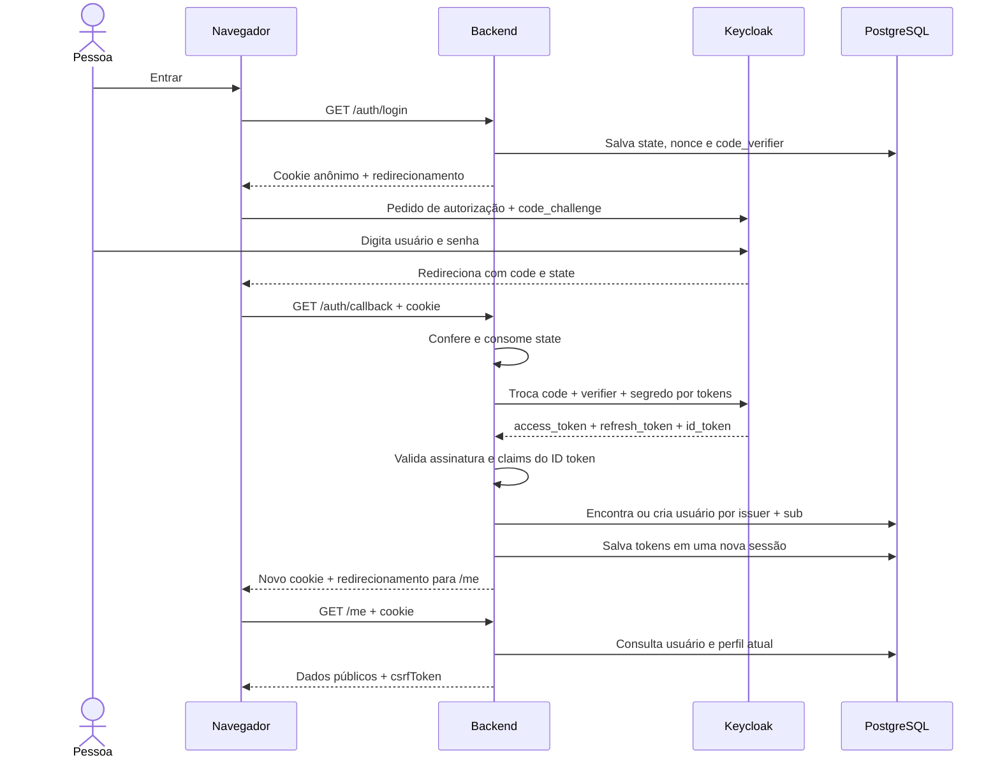
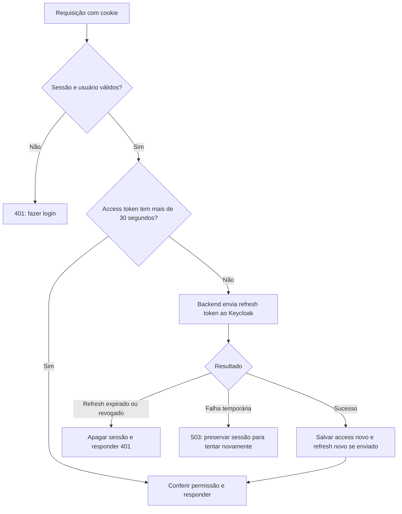

# Autenticação da Trilha: guia para estudar e executar

O backend usa **OpenID Connect, Authorization Code Flow com PKCE e sessão por cookie**. O Keycloak confere a senha; a plataforma confere a identidade recebida e decide o que a pessoa pode acessar.

Esta implementação foi construída a partir das documentações oficiais citadas no final. Não é uma cópia de um tutorial único.

## 1. Faça funcionar localmente

Na raiz do projeto, com o Docker Desktop funcionando:

```powershell
docker compose --env-file backend/.env up -d postgres keycloak
```

No `backend/.env`, mantenha as credenciais que você já configurou. Confira os endereços:

```dotenv
OIDC_ISSUER=http://localhost:8080/realms/trilha
OIDC_CLIENT_ID=trilha-backend
OIDC_REDIRECT_URI=http://localhost:3333/auth/callback
OIDC_POST_LOGOUT_REDIRECT_URI=http://localhost:3333/auth/logged-out
FRONTEND_URL=http://localhost:5173
PORT=3333
```

`OIDC_CLIENT_SECRET` é o segredo do client no Keycloak. `SESSION_SECRET` é outro segredo, aleatório, com pelo menos 32 caracteres: ele assina o cookie da plataforma. Não coloque esses segredos no React nem no Git. `DATABASE_URL` deve apontar para o PostgreSQL configurado no Compose. O arquivo `.env.example` contém o modelo.

No Keycloak, confira o **realm `trilha`**, client **`trilha-backend`**:

| Configuração | Valor / função |
| --- | --- |
| Client type | OpenID Connect |
| Client authentication | ON: o backend se autentica usando o client secret |
| Standard flow | ON: habilita Authorization Code |
| Implicit flow / Direct access grants | OFF: não são usados neste projeto |
| Valid redirect URIs | `http://localhost:3333/auth/callback` |
| Valid post logout redirect URIs | `http://localhost:3333/auth/logged-out` |
| PKCE code challenge method, nas configurações avançadas | S256 |
| Usuário de teste | Criado no realm `trilha`, habilitado, com email e senha |

Use `localhost` de forma consistente no navegador; cookies de `localhost` e `127.0.0.1` pertencem a hosts diferentes. CORS do React para nossa API é configurado no backend. A troca de tokens acontece diretamente entre backend e Keycloak.

Depois, no terminal:

```powershell
cd backend
npm install
npm run db:generate
npm run db:migrate
npm run dev
```

A migration acrescenta os campos de identidade OIDC, permite senha local nula e cria `auth_sessions`. Não apaga usuários existentes. Não execute `prisma migrate reset` para esta atualização.

Abra [iniciar login](http://localhost:3333/auth/login). Depois de entrar no Keycloak, o navegador vai para [ver minha sessão](http://localhost:3333/me). A resposta esperada tem este formato:

```json
{
  "authenticated": true,
  "user": { "id": 1, "nome": "Seu nome", "email": "voce@example.com", "perfil": "PARTICIPANTE" },
  "csrfToken": "valor-aleatorio-da-sessao"
}
```

O número, os dados e o CSRF variam. Não aparecem access token, refresh token, ID token ou senha nesse JSON.

## 2. Veja o caminho inteiro



**São duas sessões diferentes:** a sessão SSO no Keycloak e a sessão da plataforma, identificada pelo cookie `trilha.sid`.

## 3. Leia o código nesta ordem

Os trechos abaixo destacam a ideia. Os arquivos apontados contêm o tratamento completo de erros.

### Primeiro: descobrir os endereços

Arquivo: [`discover.ts`](../backend/src/oidc/discover.ts).

```ts
fetch(`${issuer}/.well-known/openid-configuration`)
```

O realm publica os endereços de autorização, tokens, chaves públicas e logout. O backend consulta esse documento ao iniciar e confere o emissor. Por isso o Keycloak precisa estar disponível antes de iniciar o backend.

### Segundo: iniciar uma tentativa de login

Arquivos: [`oidc.routes.ts`](../backend/src/rotas/oidc.routes.ts) e [`pkce.ts`](../backend/src/oidc/pkce.ts).

```ts
req.session.codeVerifier = codeVerifier;
req.session.state = randomBytes(32).toString('base64url');
req.session.nonce = randomBytes(32).toString('base64url');
await saveSession(req);
res.redirect(url.toString());
```

`state` liga o retorno ao pedido daquele navegador. `nonce` liga o ID token à tentativa. O `code_verifier` fica no servidor, enquanto seu hash, o `code_challenge`, vai no pedido ao Keycloak. A troca do código exige o verifier original. Esses valores têm funções diferentes.

### Terceiro: receber o código e obter tokens

Arquivos: [`oidc.routes.ts`](../backend/src/rotas/oidc.routes.ts) e [`exchange-code.ts`](../backend/src/oidc/exchange-code.ts).

O Express chama a função do callback quando o navegador acessa a URL registrada. Você não chama essa função manualmente. O Keycloak redireciona o navegador para ela.

```ts
const tokens = await exchangeCodeForTokens(code, codeVerifier);
const claims = await validateIdToken(tokens.id_token, nonce);
const user = await users.resolveIdentity(claims);
```

O código só é trocado depois de conferir o `state`, a duração da tentativa e os valores guardados. A tentativa é consumida antes da chamada ao Keycloak para impedir reutilização. No login, o ID token é obrigatório e precisa passar pela validação de assinatura, emissor, destinatário, expiração e nonce.

### Quarto: criar a sessão autenticada

Arquivos: [`users.ts`](../backend/src/auth/users.ts), [`oidc-session.ts`](../backend/src/middlewares/oidc-session.ts) e [`session-store.ts`](../backend/src/auth/session-store.ts).

```ts
await regenerateSession(req);
req.session.auth = {
  userId: user.id,
  // ...identidade validada, tokens, prazos e token CSRF
};
await saveSession(req);
res.redirect(303, '/me');
```

Regenerar muda o identificador da sessão após o login. O navegador recebe um cookie `HttpOnly`: o JavaScript não precisa ler seu valor. O navegador envia esse cookie nas próximas requisições. O backend busca a sessão no PostgreSQL pelo identificador.

`issuer + sub` identifica a conta no provedor. Um novo usuário entra como `PARTICIPANTE`. Email igual ao de uma conta antiga **não** vincula automaticamente as duas identidades: isso retorna 409 para que um administrador confira a titularidade. A senha do Keycloak nunca é copiada para o banco da plataforma.

### Quinto: proteger uma rota

Arquivos: [`require-session.ts`](../backend/src/auth/require-session.ts) e [`usuario.routes.ts`](../backend/src/rotas/usuario.routes.ts).

```ts
routes.get('/admin', requireSession(users), requireAdmin, (_req, res) => {
  res.json({ message: 'Acesso administrativo autorizado.', user: res.locals.user });
});
```

A ordem importa: `requireSession` identifica a pessoa e consulta o perfil atual no banco; `requireAdmin` exige `ADMIN`; só então o Express executa a resposta da rota. Sem sessão: **401**. Com sessão, mas sem permissão: **403**. Esconder um botão no React não substitui essas verificações.

Para promover conscientemente uma conta, depois do primeiro login, execute no terminal do backend:

```powershell
npm run user:role -- voce@example.com ADMIN
```

Isso é uma operação do administrador que possui acesso ao servidor. O cadastro não aceita que a pessoa escolha seu próprio perfil. Nenhum usuário foi promovido automaticamente por esta implementação.

### Sexto: renovar o access token

Arquivos: [`require-session.ts`](../backend/src/auth/require-session.ts), [`exchange-code.ts`](../backend/src/oidc/exchange-code.ts) e [`session-lock.ts`](../backend/src/auth/session-lock.ts).

```ts
if (auth.accessExpiresAt <= Date.now() + 30_000) {
  const tokens = await refreshTokens(auth.refreshToken);
  // Valida o novo ID token, caso o provedor o envie.
  applyTokens(auth, tokens);
  await saveSession(req);
}
```

O backend faz isso quando chega uma requisição protegida. Se o access token ainda tem mais de 30 segundos, continua normalmente. Se está perto de expirar ou já expirou, o backend envia o refresh token ao endpoint de tokens com `grant_type=refresh_token`.



**O objetivo é obter outro access token.** O Keycloak também pode devolver outro refresh token; nesse caso, o backend substitui o anterior. Isso é rotação. O ID token no refresh é opcional; quando presente, conferimos a identidade e o nonce se ele vier. Requisições simultâneas da mesma sessão são serializadas para não usar o mesmo refresh token duas vezes ao mesmo tempo.

Os access tokens ficam disponíveis no backend para futuras chamadas a APIs protegidas. As rotas locais deste projeto autorizam por **sessão e perfil no banco**, não por um Bearer JWT enviado pelo React. Não foi implementado um segundo modo de autenticação Bearer para clientes externos.

### Sétimo: sair

Arquivo: [`oidc.routes.ts`](../backend/src/rotas/oidc.routes.ts).

Abra [sair](http://localhost:3333/auth/logout) e clique no botão. O GET só mostra o formulário. O POST exige CSRF, apaga a sessão e limpa o cookie, tenta revogar o refresh token e redireciona ao endpoint de logout do Keycloak.

O logout padronizado usa `id_token_hint` no redirecionamento para identificar a sessão no provedor. Access token e refresh token continuam fora do navegador. O endereço de retorno precisa estar cadastrado em **Valid post logout redirect URIs**.

Se o Keycloak estiver indisponível, a sessão local já terá sido encerrada; a sessão SSO do provedor pode continuar até o logout remoto ser concluído ou ela expirar.

## 4. Contrato para o futuro frontend

| Rota | O que faz |
| --- | --- |
| `GET /auth/login` | Inicia login por navegação/redirecionamento |
| `GET /auth/callback` | Recebe o retorno do Keycloak |
| `GET /me` | Retorna usuário público e CSRF, ou 401 |
| `GET /admin` | Exige perfil ADMIN |
| `GET /usuarios?email=...` | Lista até 100 usuários públicos, somente ADMIN; email é opcional |
| `POST /auth/refresh` | Confere/renova quando necessário; exige sessão e CSRF |
| `GET /auth/logout` | Mostra formulário para sair |
| `POST /auth/logout` | Encerra sessão e redireciona ao logout do Keycloak |
| `GET /auth/logged-out` | Página de retorno informativa, não modifica sessão |

Exemplo de consumo futuro, ainda não integrado ao React:

```ts
// Entrar: navegação, não fetch.
window.location.assign('http://localhost:3333/auth/login');

// Ao abrir a área administrativa: perguntar ao backend quem está logado.
const response = await fetch('http://localhost:3333/me', {
  credentials: 'include', // permite enviar/receber o cookie da API
});
if (response.status === 401) {
  // Mostrar a tela ou botão de login.
} else if (response.ok) {
  const { user, csrfToken } = await response.json();
  // user.perfil orienta a interface; a permissão efetiva continua no backend.
}
```

Chamadas POST autenticadas incluem `credentials: 'include'` e o header `X-CSRF-Token` recebido em `/me`. Para logout com redirecionamento de página, use o formulário fornecido por `/auth/logout`. Não salve tokens no localStorage. O callback atualmente termina em `/me`; a navegação para a tela React será integrada na etapa do frontend.

## 5. Prazos e limites desta versão

- Tentativa de login: 10 minutos. Sessão local: 1 hora sem atividade, com limite absoluto de 8 horas verificado nas rotas protegidas. Tokens seguem os prazos informados pelo Keycloak.
- Sessões persistem no PostgreSQL e sobrevivem a reinício do Node se o `SESSION_SECRET` continuar igual. Registros expirados são removidos ao iniciar e a cada 15 minutos.
- O lock de requisições é **por processo Node**. Execute uma instância. Múltiplas réplicas exigem coordenação distribuída antes de habilitar rotação de refresh em paralelo.
- Logout iniciado diretamente no painel do Keycloak não apaga imediatamente a sessão local. A revogação é percebida na próxima renovação; back-channel logout não está implementado.
- HTTPS é obrigatório em produção e o cookie usa `Secure`. `TRUST_PROXY=1` só deve ser usado atrás de um proxy confiável. O Compose com `start-dev` é para estudo local.
- Tokens ficam no banco da aplicação: restrinja acesso ao banco e aos backups. Não exponha a tabela de sessões em endpoints ou logs.
- As classes antigas de login por senha permanecem no repositório como histórico de estudo, mas as rotas antigas retornam 410. `JWT_SECRET` não autentica as rotas OIDC atuais.

## 6. Testes

```powershell
cd backend
npm test
```

A suíte sobe um provedor OIDC de teste local, assina JWTs com uma chave RSA e exercita os endpoints HTTP do backend. Verifica assinatura/claims, state e nonce, troca de cookie, expiração, permissões, refresh concorrente, rotação, erros do provedor, CSRF e logout. Esse teste automatizado não usa sua senha do Keycloak.

Os testes de persistência substituem o acesso ao Prisma por operações em memória para conferir criação/vínculo de usuários e o contrato do Store. Eles não substituem aplicar a migration e testar o login com seu PostgreSQL e Keycloak reais.

Para observar o refresh manualmente, reduza o Access Token Lifespan no realm de desenvolvimento, faça um novo login, espere o prazo e abra `/me`. O backend renova na requisição seguinte. Se o refresh também tiver expirado, o resultado será 401 e será necessário entrar novamente.

## 7. Referências oficiais usadas

- [Keycloak: endpoints OIDC](https://www.keycloak.org/securing-apps/oidc-layers) — discovery, autorização, token, revogação e logout.
- [OpenID Connect Core: validação do ID token](https://openid.net/specs/openid-connect-core-1_0.html#IDTokenValidation) — regras de assinatura e claims.
- [OpenID Connect Core: refresh](https://openid.net/specs/openid-connect-core-1_0.html#RefreshTokenResponse) — resposta de renovação e validação do ID token opcional.
- [OpenID Connect: RP-Initiated Logout](https://openid.net/specs/openid-connect-rpinitiated-1_0.html) — encerramento da sessão no provedor.
- [Express: express-session](https://expressjs.com/en/resources/middleware/session/) — cookie, regeneração, persistência e interface do Store.

Ordem sugerida de estudo: execute o login; leia `/auth/login`; leia o callback; acompanhe `/me`; estude o refresh; por último, teste o logout. Em cada etapa, associe o trecho de código à seta correspondente no diagrama.
